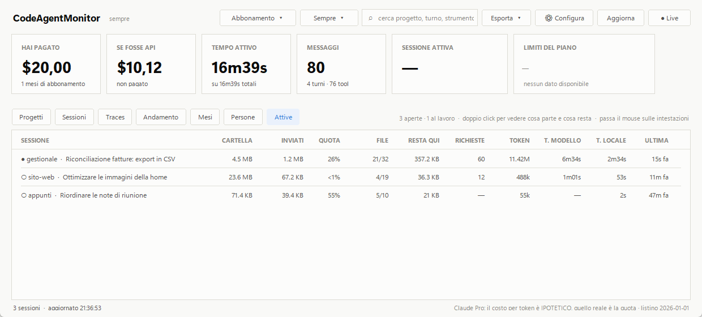
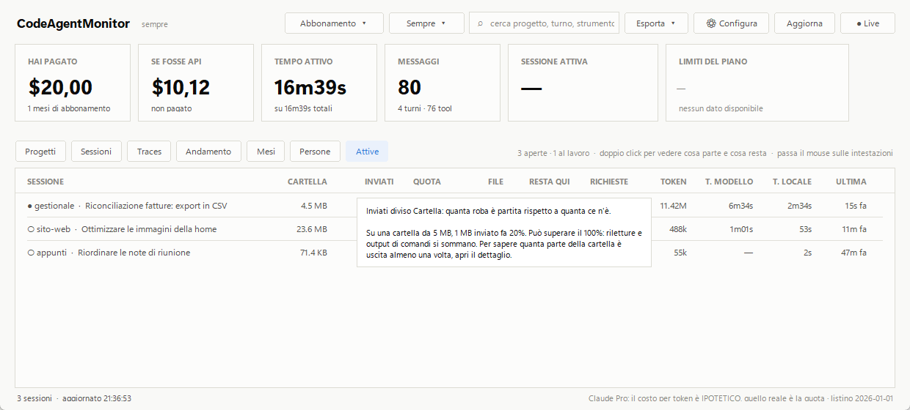
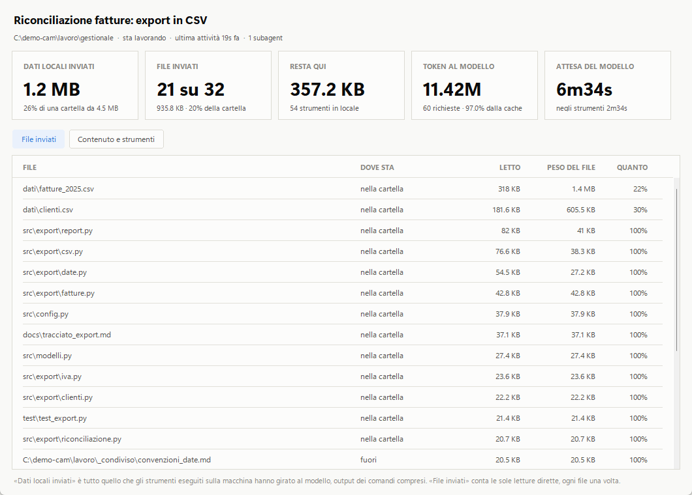

# Quanti dei miei dati vanno al modello? — la guida semplice

Per chi usa Claude Code e vuole una risposta a una domanda sola, senza leggere il resto:

> **Dei file che ho sul computer, quanti sono stati spediti ad Anthropic?**

Non serve sapere programmare. Servono cinque minuti.

*Le schermate usano progetti inventati: i nomi e i numeri sono d'esempio.*

---

## L'idea, in tre righe

Quando lavori con Claude Code succedono due cose diverse:

1. **Il tuo computer** apre i file, esegue i comandi, salva le modifiche.
2. **Il modello**, che sta sui server di Anthropic, ragiona e decide cosa fare.

Il modello non vede il tuo disco. Vede **solo quello che il computer gli spedisce**: per
esempio, quando gli serve un file, Claude Code lo legge e glielo manda. Questa scheda conta
quanto è stato mandato, e lo confronta con quanto c'è nella cartella.

Come se avessi un archivio di cento faldoni e un consulente al telefono: la scheda ti dice
quanti faldoni gli hai letto ad alta voce, e quali.

---

## Passo 1 — Installa (una volta sola)

Ti serve **Python**, versione 3.9 o successiva. Se non sai se ce l'hai, apri il terminale e
scrivi:

```bat
python --version
```

Se risponde con un numero (`Python 3.12.4`), ce l'hai. Se dice che il comando non esiste,
scaricalo da [python.org](https://www.python.org/downloads/) e installalo — su Windows spunta
la casella **«Add Python to PATH»**.

Poi scarica il programma. Con git:

```bat
git clone https://github.com/mlosavio/CodeAgentMonitor.git
cd CodeAgentMonitor
copy config.example.json config.json
```

Senza git: dalla pagina del progetto su GitHub premi **Code → Download ZIP**, scompatta, e
apri il terminale dentro la cartella scompattata. Poi esegui solo l'ultima riga (`copy …`).

Non c'è altro da installare.

## Passo 2 — Apri Claude Code

Lavora come fai di solito: nel terminale, in VS Code o nell'app. La scheda mostra le sessioni
**aperte in questo momento**, quindi ne serve almeno una.

## Passo 3 — Apri la scheda

Dalla cartella del programma:

```bat
python cam_gui.py --tab attive
```

Si apre questa finestra. Ogni riga è una sessione di Claude Code aperta.



La prima volta può metterci qualche secondo. Poi **si aggiorna da sola**: lasciala aperta
mentre lavori e guarda i numeri salire.

---

## Passo 4 — Leggi tre numeri

Prendi la prima riga e leggi solo queste tre colonne. Il resto, per ora, ignoralo.

| Colonna | In parole semplici | Nell'esempio |
|---|---|---|
| **Cartella** | Quanto pesa la cartella in cui stai lavorando | 4,5 MB |
| **Inviati** | Quanto è stato spedito al modello | 1,2 MB |
| **Quota** | Il secondo diviso il primo | 26% |

Tradotto: **della cartella «gestionale», grande 4,5 MB, è partito 1,2 MB — circa un quarto.**

Il pallino a sinistra dice cosa sta facendo la sessione:

- `●` sta lavorando
- `○` aspetta che tu scriva qualcosa

Non ricordi cosa vuol dire una colonna? **Ferma il mouse sul suo titolo** e te lo spiega.



## Passo 5 — Guarda quali file sono partiti

Fai **doppio click** su una riga. Si apre l'elenco dei file spediti, dal più grosso.



Per ogni file:

| Colonna | In parole semplici |
|---|---|
| **File** | Il nome del file |
| **Dove sta** | *nella cartella* = è un file del progetto. *fuori* = Claude Code è andato a leggerlo altrove |
| **Letto** | Quanto ne è stato spedito |
| **Peso del file** | Quanto è grande il file |
| **Quanto** | Che parte del file è partita: 100% = tutto, 22% = solo un pezzo |

Nell'esempio, `fatture_2025.csv` pesa 1,4 MB ma ne è partito il 22%: Claude Code ha letto solo
l'inizio. Gli altri file sono partiti per intero.

In alto, la tessera **File inviati** riassume: *21 su 32* vuol dire che 21 file della cartella
sono stati letti e spediti, e 11 no.

---

## E i numeri che ho ignorato?

Non servono per rispondere alla domanda, ma eccoli in una riga ciascuno:

| Colonna | Cosa vuol dire |
|---|---|
| **File** | Quanti file della cartella sono partiti, sul totale: `21/32` |
| **Resta qui** | Roba che il computer ha maneggiato **senza** spedirla. Più è alto, meglio è |
| **Richieste** | Quante volte Claude Code ha «telefonato» al modello |
| **Token** | Una misura di quanto lavora il modello. **Non** dice quanti dati sono partiti: non usarla per quello |
| **T. modello** | Quanto tempo hai aspettato le risposte |
| **T. locale** | Quanto tempo ci ha messo il tuo computer |
| **Ultima** | Da quanto la sessione è ferma |

---

## Domande che vengono in mente

**La scheda è vuota: «nessuna sessione di Claude Code aperta».**
Non c'è nessun Claude Code aperto, o l'hai appena aperto e non gli hai ancora scritto niente.
Scrivigli qualcosa e aspetta due secondi.

**La Quota supera il 100%. Ha spedito più di quello che ho?**
No. Se lo stesso file viene letto due volte, conta due volte. Per sapere quanta parte della
cartella è uscita *almeno una volta*, apri il dettaglio e guarda la tessera **File inviati**:
quel numero non supera mai il 100%.

**La Quota è bassissima, tipo «<1%». Vuol dire che non è partito quasi niente?**
Non per forza. La cartella conta tutto, anche foto, video e archivi che Claude Code non legge.
Se hai 20 MB di immagini e 100 KB di testi, anche spedendo tutti i testi la quota resta sotto
l'1%. Guarda la colonna **File** e l'elenco: ti dicono cosa è partito davvero.

**Vedo dei trattini «—» al posto dei numeri.**
Vuol dire «non si sa», non «zero». Di solito è una versione vecchia di Claude Code:
aggiornalo e apri una sessione nuova.

**Un file che non compare nell'elenco è sicuramente rimasto sul mio computer?**
No, e questo è il limite da ricordare. L'elenco mostra i file che Claude Code ha *letto
direttamente*. Se un comando ne ha stampato il contenuto, quel contenuto è partito lo stesso:
è contato in **Inviati**, ma non si sa di quale file fosse, quindi nell'elenco non c'è.
Inoltre non sono contati qui quello che scrivi tu nei messaggi e i file di istruzioni
(`CLAUDE.md`) che Claude Code allega da solo.

**Il programma spedisce qualcosa a qualcuno?**
No. Legge dei file che Claude Code scrive già sul tuo computer, e basta. Non si collega a
Internet e non modifica niente.

**Posso vederlo senza la finestra?**
Sì, nel terminale:

```bat
python cam.py --flusso
```

**Posso guardare una sessione che ho già chiuso?**
Sì, col suo codice (le prime otto lettere bastano):

```bat
python cam.py --flusso --session a1b2c3d4
```

---

## Per saperne di più

Questa guida dice l'essenziale. Il significato esatto di ogni colonna, da dove vengono i
numeri e tutti i limiti sono nella sezione
[Modello o macchina](../README.md#modello-o-macchina) del README.
